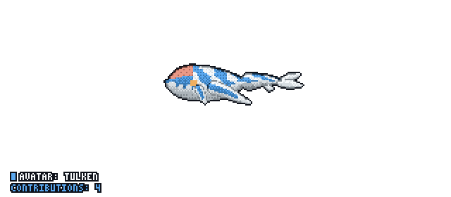
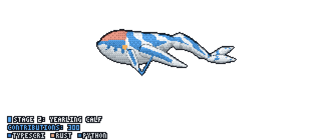
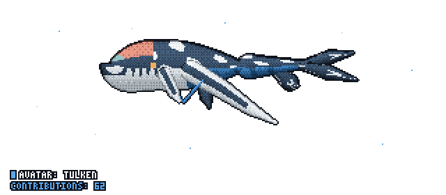
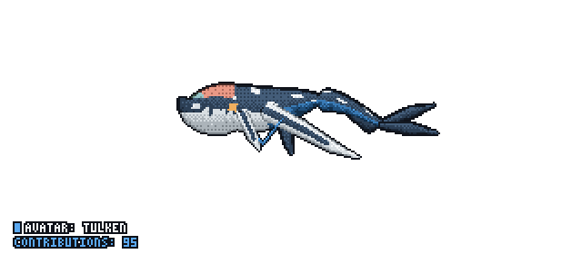
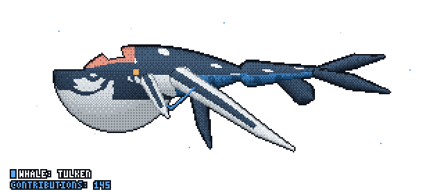
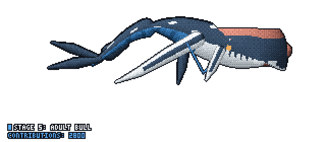
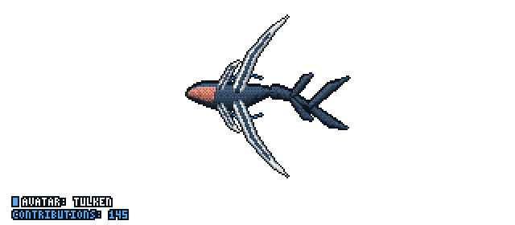
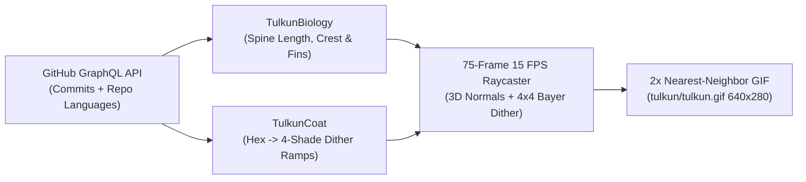
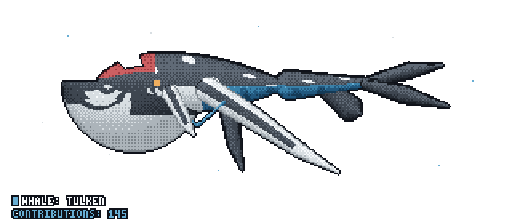

# 🐋 GitTulkun (`git-tulkun`)


> Draw a procedural pixel-art Pandoran **Tulkun** leviathan whale from a GitHub account's commits and language colors, rendered as a seamless 15 FPS looping GIF for your GitHub profile `README.md`.

<p align="center">
  
  <br />
  <em>Live Tulkun generated from <a href="https://github.com/PramudithaN">@PramudithaN</a>'s public GitHub activity (1,059 contributions • Adult Male Bull)</em>
</p>

---

## 🧬 How Commit Evolution Works (`Baby Calf` $\rightarrow$ `Adult Bull`)

Every commit you push to GitHub feeds your Tulkun's anatomical growth. Instead of static spritesheets, **GitTulkun** uses a continuous mathematical spline & signed-distance-field (SDF) engine to morph the whale's proportions, sensor crest, 6 pectoral flippers, *kuru* neural whips, jaw war-stripes, and tail flukes across **5 distinct biological stages**:

| Stage | Commits Needed | Live 15 FPS Animation | Biological Changes Unlocked |
| :--- | :---: | :---: | :--- |
| **Stage 1**<br/>**Baby Calf** | **`1 – 14`**<br/>commits |  | • Chubby, higher body-fat ratio (`64px` spine)<br/>• Blunt teal-blue snout with a flat oval sensor dimple<br/>• Light cream dorsal swirl patches & bright cream belly<br/>• Stubby agile fins & **pale cream tail flukes** |
| **Stage 2**<br/>**Yearling Calf** | **`15 – 39`**<br/>commits |  | • Spine lengthens (`95px`) and slims down<br/>• **Kuru neural whips** sprout behind the anterior opercular flippers<br/>• Tail flukes begin filling in with dark pigment at the base |
| **Stage 3**<br/>**Adolescent** | **`40 – 74`**<br/>commits |  | • **Sensor crest** begins rising and sloping forward<br/>• All **6 pectoral & ventral flippers** elongate with crisp white leading edges<br/>• Secondary **pelvic accessory paddles** widen under the tail stock |
| **Stage 4**<br/>**Adult Female** | **`75 – 114`**<br/>commits |  | • Dark charcoal carapace armor replaces the pale calf dorsal patches<br/>• Forward-jutting **sloped maroon sensor crest** with an olive-gold front tip<br/>• **5 sharp sawtooth jaw triangles** & segmented cerulean tail pleats |
| **Stage 5**<br/>**Adult Male Bull** | **`115+`**<br/>commits |  | • Maximum **`186px` leviathan length** & full scythe-wing span<br/>• Towering vertical **hooked hammer-crest** with concave rear overhang<br/>• **6 serrated jaw triangles** & white carapace battle-scars |

---

## 🎥 3 Camera Perspectives (`--view`)

You can render your Tulkun from **3 different camera angles** using the `view` input (`side`, `dive`, or `top`):

| Camera Mode | Live Animated Preview | Description |
| :--- | :---: | :--- |
| **`view: side`**<br/>*(Default)* |  | **Lateral Side Swim**: Best view to showcase the hooked hammer-crest, serrated jaw war-stripes, looping *kuru* whip, and vertical tail up/down strokes. |
| **`view: dive`** |  | **3/4 Dynamic Dive (*Payakan* Pose)**: Shows the arched dorsal carapace, split crimson-lined lateral head scoop, and sweeping foreground scythe flipper. |
| **`view: top`** |  | **Dorsal Top-Down Swim**: Shows the full 10-limb wingspan (opercular fins, primary scythe wings, trailing *kuru* whips, pelvic paddles, and forked caudal flukes). |

---

## 🎨 How GitHub Language Pigments & Pixel-Art Shading Work



1. **Dynamic Language Color Ramps (`src/coat.rs`)**:
   - `git-tulkun` reads the official GitHub hex colors of your top languages (e.g., TypeScript `#3178c6`, Rust `#dea584`, Python `#3572A5`) and converts each one into a **4-shade pixel-art ramp** (`[shadow, mid_dark, mid_light, highlight]`):
     - **Primary Language (`#1`)** $\rightarrow$ Tints the ventral pleated belly, calf skin, and dark dorsal carapace armor.
     - **Secondary Language (`#2`)** $\rightarrow$ Tints the reddish-maroon sensor crest organ core.
     - **Tertiary Language (`#3`)** $\rightarrow$ Tints the sensor crest tip highlights.
   - Prefer the movie's exact colors? Set `canon: "true"` (or `--canon` on the CLI):
     <p align="center">
       
     </p>

2. **3D Cylindrical Normal Lighting & `4×4` Ordered Bayer Dithering (`src/render.rs`)**:
   - Every pixel on the Tulkun's spine and appendages computes a 3D surface normal $\vec{n} = (n_x, n_y, \sqrt{1 - n_x^2 - n_y^2})$ dot-producted against a directional ocean light source `[-0.30, -0.62, 0.72]`.
   - Brightness is quantized across the 4-shade ramp using a `4×4` Bayer ordered dither matrix and wrapped in a crisp `1px` dark outline (`#0f121a`).

3. **Slow Deep-Ocean Cetacean Swimming Physics & Bottom-Left Metrics HUD**:
   - **75-Frame Deep-Ocean Glide (5.0s Loop at 15 FPS)**: Massive cetaceans move with slow, weighty grace. A single-harmonic traveling wave glides gently from chest to tail peduncle without erratic vertical bounce:
     $$\Delta y(u, t) = A_{\text{bob}}\sin(\omega t)(1 - u) + A_{\text{tail}}\sin(1.45\pi u - \omega t)\,u^{1.45}$$
   - **Rest-Pose Camera Stabilization**: Camera framing is locked to the Tulkun's resting pose (`loop_turn = 0.0`) so flapping flippers never shift the camera center.
   - **Bottom-Left Pixel-Art Metrics HUD**: Every rendered GIF and PNG displays a crisp `3×5` outlined pixel-art badge in the bottom-left corner showing **`WHALE: TULKEN`** alongside your live **`CONTRIBUTIONS: <count>`**.

---

## 🚀 Quick Start (Add to Your GitHub Profile `README.md`)

Anyone can add a swimming Tulkun to their `<username>/<username>` GitHub profile repository in **2 steps**:

### Step 1: Create `.github/workflows/tulkun.yml` in your profile repo

```yaml
name: Draw Profile Tulkun

on:
  schedule:
    - cron: "0 0 * * *" # Updates every night at midnight UTC
  workflow_dispatch:     # Allows manual 1-click run from the Actions tab

permissions:
  contents: write

jobs:
  tulkun:
    runs-on: ubuntu-latest
    steps:
      - name: Check out profile repository
        uses: actions/checkout@v4

      - name: Generate Tulkun GIF & PNG
        uses: PramudithaN/git-tulkun@v0.1.1
        with:
          login: ${{ github.repository_owner }}
          view: side        # Options: side | dive | top
          canon: "false"    # Set to "true" to use canon Avatar colors instead of language colors
          output-dir: tulkun

      - name: Commit updated Tulkun to profile repo
        run: |
          git config user.name "github-actions[bot]"
          git config user.email "41898282+github-actions[bot]@users.noreply.github.com"
          git add tulkun/tulkun.gif tulkun/tulkun.png tulkun/preview.html
          git diff --cached --quiet || git commit -m "chore: update Tulkun from latest GitHub activity"
          git push
```

### Step 2: Embed the GIF in your `README.md`

```html
<p align="center">
  /<YOUR_USERNAME>/main/tulkun/tulkun.gif" width="640" alt="My GitTulkun swimming" />
</p>
```

---

## ⚙️ GitHub Action Inputs

| Input | Default | Description |
| :--- | :--- | :--- |
| `login` | `${{ github.repository_owner }}` | GitHub username whose commits and languages to read. |
| `view` | `side` | Camera perspective: `side` (Lateral Side Swim), `dive` (3/4 Dynamic Dive), or `top` (Dorsal Top-Down). |
| `canon` | `"false"` | If `"true"`, uses canon Pandoran Tulkun colors instead of tinting with GitHub language colors. |
| `output-dir` | `tulkun` | Output folder for `tulkun.gif`, `tulkun.png`, and `preview.html`. |
| `token` | `${{ github.token }}` | GitHub token for public GraphQL queries (the default built-in token is sufficient). |

---

## 💻 CLI Usage (Local Development)

Download a pre-built binary from the [Releases page](https://github.com/PramudithaN/git-tulkun/releases) or run with [Rust](https://rustup.rs/) and the [GitHub CLI (`gh`)](https://cli.github.com/):

```bash
# 1. Collect a live GitHub account snapshot
cargo run --release -- collect <GITHUB_USERNAME> --output snapshot.json

# 2. Render tulkun/tulkun.gif, tulkun/tulkun.png, and tulkun/preview.html
cargo run --release -- render snapshot.json --output-dir tulkun --view side

# 3. Demo mode (test any commit count immediately without GitHub authentication)
cargo run --release -- demo --commits 6   --output-dir tulkun-calf
cargo run --release -- demo --commits 60  --output-dir tulkun-adolescent
cargo run --release -- demo --commits 145 --output-dir tulkun-bull --view dive
```

---

## 📁 Project Structure

```text
git-tulkun/
├── .github/workflows/
│   ├── release.yml      # Builds Linux, macOS & Windows release binaries on v*.*.* tags
│   └── tulkun.yml       # Nightly profile Tulkun update workflow
├── docs/                # Pre-rendered animated GIF showcase for all 5 stages & 3 views
├── src/
│   ├── coat.rs          # GitHub language hex -> 4-shade pixel dither ramps
│   ├── collect.rs       # GitHub GraphQL collector via `gh api graphql`
│   ├── history.rs       # Contribution calendar & language share models
│   ├── lib.rs           # Library root
│   ├── main.rs          # CLI (`collect`, `render`, `demo`)
│   ├── output.rs        # 2x nearest-neighbor GIF, PNG, and HTML preview encoders
│   └── render.rs        # Full-body swimming Tulkun spline & 4x4 Bayer dither engine
├── tulkun/              # Live rendered output for @PramudithaN
├── action.yml           # Composite GitHub Action (downloads release binary or builds from source)
└── Cargo.toml           # Rust package manifest
```

---

## 📄 License

MIT © [Pramuditha Nadun](https://github.com/PramudithaN)
