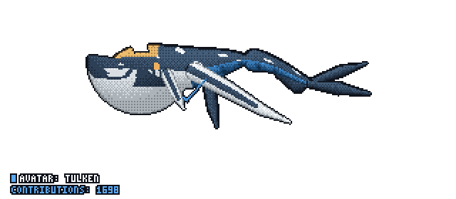
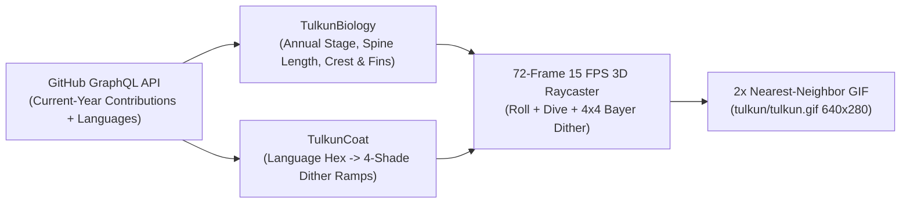

# GitTulkun (`git-tulkun`)


> Procedural pixel-art Pandoran **Tulkun** leviathan whale generated from your GitHub contributions and repository language colors, rendered as a seamless 15 FPS looping GIF for your GitHub profile or repository `README.md`.

<p align="center">
  
  <br />
  <em>Live Tulkun generated from <a href="https://github.com/PramudithaN">@PramudithaN</a>'s current-year GitHub activity (1,072 contributions - Adult Male Bull)</em>
</p>

---

## Add to Your GitHub Profile or Repository `README.md`

You can add a live, self-updating Tulkun card to your GitHub profile repository (`<username>/<username>`) or any project repository in **3 simple steps**:

### Step 1: Enable Workflow Write Permissions

In your repository on GitHub, go to **Settings** $\rightarrow$ **Actions** $\rightarrow$ **General** $\rightarrow$ **Workflow permissions**, select **Read and write permissions**, and click **Save**.

### Step 2: Create `.github/workflows/tulkun.yml`

Create a new file at `.github/workflows/tulkun.yml` in your repository with the following configuration:

```yaml
name: Update Tulkun

on:
  schedule:
    - cron: "0 0 * * *" # Updates automatically every day at midnight UTC
  workflow_dispatch:     # Allows manual triggering from the Actions tab
  push:
    branches: [main]

permissions:
  contents: write

jobs:
  tulkun:
    runs-on: ubuntu-latest
    steps:
      - name: Check out repository
        uses: actions/checkout@v4

      - name: Generate Tulkun GIF and PNG
        uses: PramudithaN/git-tulkun@v0.1.6
        with:
          login: ${{ github.repository_owner }}
          view: side        # Options: side (full 3D swim, bank & top-down roll loop) | dive | top
          canon: "false"    # Set to "true" for movie colors instead of GitHub language colors
          output-dir: tulkun

      - name: Commit and push updated Tulkun
        run: |
          git config user.name "github-actions[bot]"
          git config user.email "41898282+github-actions[bot]@users.noreply.github.com"
          git add tulkun/tulkun.gif tulkun/tulkun.png tulkun/preview.html
          git diff --cached --quiet || git commit -m "chore: update Tulkun from latest GitHub activity"
          git push
```

After committing this file, open the **Actions** tab in your repository, select **Update Tulkun**, and click **Run workflow** to generate your initial `tulkun/tulkun.gif`.

### Step 3: Embed the Card in Your `README.md`

Add the following snippet anywhere in your `README.md`:

```markdown
<p align="center">
  
</p>
```

---

## Annual Lifecycle and Commit Evolution (`Baby Calf` $\rightarrow$ `Adult Bull`)

On **January 1st** of every calendar year, your Tulkun resets to its **Stage 1 Baby Calf** form and grows continuously throughout the year according to your annual contribution rate.

Instead of static spritesheets, `git-tulkun` uses a mathematical spline and signed-distance-field (SDF) renderer to evolve the whale's body length, sensor crest, 6 pectoral flippers, *kuru* neural whips, jaw war-stripes, and tail flukes across **5 biological stages**:

| Stage | Current-Year Contributions | Live 15 FPS Animation | Anatomical Changes Unlocked |
| :--- | :---: | :---: | :--- |
| **Stage 1**<br/>**Baby Calf** | **`1 – 14`**<br/>contributions |  | Compact `64px` spine, blunt teal-blue snout with a flat oval sensor dimple, light cream dorsal swirl patches, bright cream belly, and stubby fins with pale cream tail flukes. |
| **Stage 2**<br/>**Yearling Calf** | **`15 – 39`**<br/>contributions |  | Spine lengthens (`95px`) and slims down; *kuru* neural whips sprout behind the anterior opercular flippers while tail flukes begin darkening at the base. |
| **Stage 3**<br/>**Adolescent** | **`40 – 74`**<br/>contributions |  | Sensor crest rises and slopes forward; all 6 pectoral and ventral flippers elongate with crisp white leading edges, and secondary pelvic accessory paddles widen under the tail stock. |
| **Stage 4**<br/>**Adult Female** | **`75 – 114`**<br/>contributions |  | Dark charcoal carapace armor replaces the pale calf dorsal patches; forward-jutting sloped maroon sensor crest with an olive-gold front tip, 5 sharp sawtooth jaw triangles, and segmented cerulean tail pleats. |
| **Stage 5**<br/>**Adult Male Bull** | **`115+`**<br/>contributions |  | Maximum `186px` leviathan length and full scythe-wing span; towering vertical hooked hammer-crest with concave rear overhang, 6 serrated jaw triangles, and white carapace battle-scars. |

---

## Camera Perspectives (`view`)

You can render your Tulkun from **3 camera modes** using the `view` input (`side`, `dive`, or `top`):

| Camera Mode | Live Animated Preview | Description |
| :--- | :---: | :--- |
| **`view: side`**<br/>*(Default)* |  | **3D Swim, Bank & Top-Down Roll Loop**: Smoothly transitions across a 72-frame (`4.8s`) cycle from **Lateral Side Profile** (hooked hammer-crest and jaw war-stripes) into a **3/4 Banking Dive** and a **Full Top-Down Dorsal Roll** (spreading all 10 limbs symmetrically) before banking back to side profile. |
| **`view: dive`** |  | **3/4 Dynamic Dive (*Payakan* Pose)**: Displays the arched dorsal carapace, split crimson-lined lateral head scoop, and sweeping foreground scythe flipper. |
| **`view: top`** |  | **Dorsal Top-Down Swim**: Locks the camera directly overhead to showcase the full 10-limb wingspan (opercular fins, primary scythe wings, trailing *kuru* whips, pelvic paddles, and forked caudal flukes). |

---

## How the Rendering Engine Works



1. **Dynamic Language Color Ramps (`src/coat.rs`)**:
   - `git-tulkun` queries the official GitHub hex colors of your top repository languages (such as TypeScript `#3178c6`, Rust `#dea584`, and Python `#3572A5`) and converts each into a **4-shade pixel-art ramp** (`[shadow, mid_dark, mid_light, highlight]`):
     - **Primary Language (`#1`)**: Tints the ventral pleated belly, calf skin, and dark dorsal carapace armor.
     - **Secondary Language (`#2`)**: Tints the sensor crest organ core.
     - **Tertiary Language (`#3`)**: Tints the sensor crest tip highlights.
   - To use the movie's canonical colors instead of repository language colors, set `canon: "true"` (or pass `--canon` on the CLI):
     <p align="center">
       
     </p>

2. **3D Cylindrical Normal Lighting and `4x4` Ordered Bayer Dithering (`src/render.rs`)**:
   - Each pixel across the spine and appendages computes a 3D surface normal $\vec{n} = (n_x, n_y, \sqrt{1 - n_x^2 - n_y^2})$ illuminated by a directional light vector `[-0.30, -0.62, 0.72]`, rotated continuously by the whale's barrel-roll angle $\phi(t)$.
   - Surface brightness is quantized across the 4-shade ramp using a `4x4` Bayer ordered dither matrix and bordered with a `1px` outline (`#0f121a`) for contrast on both light and dark GitHub themes.

3. **3D Rolling Maneuvers, Cetacean S-Wave Physics, and Bottom-Left Metrics HUD**:
   - **72-Frame 3D Swim, Bank, and Roll Loop (4.8s at 15 FPS)**: Across each cycle, the Tulkun performs two complete S-wave tail strokes while smoothly rolling through **Lateral Side Cruise** $\rightarrow$ **3/4 Banking Dive** $\rightarrow$ **Top-Down Dorsal Roll** $\rightarrow$ **Side Recovery**, projecting all 10 bilateral limbs and rotating the ventral belly pleats, jaw war-stripes, amber eye, and dorsal carapace bands in 3D:
     $$\Delta y(u, t) = A_{\text{bob}}\sin(2\omega t)(1 - u)^{1.3} + A_{\text{tail}}\sin(2.35\pi u - 2\omega t)\,u^{0.92} + A_{\text{dive}}(u, t)$$
   - **Full-Envelope Camera Stabilization**: The camera bounding box is pre-computed across the complete 12-phase 3D roll and stroke envelope so the whale's wingspan and tail strokes never clip or bounce the viewport.
   - **Bottom-Left Pixel-Art Metrics HUD**: Every rendered image includes a `3x5` outlined pixel-art badge in the bottom-left corner displaying **`AVATAR: TULKEN`** and your current-year **`CONTRIBUTIONS: <count>`**.

---

## GitHub Action Inputs

| Input | Default | Description |
| :--- | :--- | :--- |
| `login` | `${{ github.repository_owner }}` | GitHub username whose current-year contributions and repository languages to read. |
| `view` | `side` | Camera perspective: `side` (Lateral Side Swim), `dive` (3/4 Dynamic Dive), or `top` (Dorsal Top-Down). |
| `canon` | `"false"` | Set to `"true"` to use canonical Pandoran Tulkun colors instead of GitHub language colors. |
| `output-dir` | `tulkun` | Output directory for `tulkun.gif`, `tulkun.png`, and `preview.html`. |
| `token` | `${{ github.token }}` | GitHub token for public GraphQL queries (the default built-in token is sufficient). |

---

## CLI Usage (Local Development)

Download a pre-built binary from the [Releases page](https://github.com/PramudithaN/git-tulkun/releases) or build from source using [Rust](https://rustup.rs/) and the [GitHub CLI (`gh`)](https://cli.github.com/):

```bash
# 1. Collect a live GitHub account snapshot
cargo run --release -- collect <GITHUB_USERNAME> --output snapshot.json

# 2. Render tulkun/tulkun.gif, tulkun/tulkun.png, and tulkun/preview.html
cargo run --release -- render snapshot.json --output-dir tulkun --view side

# 3. Demo mode (preview any contribution count without GitHub authentication)
cargo run --release -- demo --commits 6   --output-dir tulkun-calf
cargo run --release -- demo --commits 60  --output-dir tulkun-adolescent
cargo run --release -- demo --commits 145 --output-dir tulkun-bull --view dive
```

---

## Project Structure

```text
git-tulkun/
├── .github/workflows/
│   ├── release.yml      # Builds Linux, macOS, and Windows release binaries on v*.*.* tags
│   └── tulkun.yml       # Scheduled workflow that updates tulkun/tulkun.gif
├── docs/                # Pre-rendered animated GIF showcase for all 5 stages and 3 camera views
├── src/
│   ├── coat.rs          # GitHub language hex to 4-shade pixel dither ramps
│   ├── collect.rs       # GitHub GraphQL collector via `gh api graphql`
│   ├── history.rs       # Annual contribution calendar reset and language share models
│   ├── lib.rs           # Library root
│   ├── main.rs          # CLI entrypoint (`collect`, `render`, `demo`)
│   ├── output.rs        # 2x nearest-neighbor GIF, PNG, and HTML preview encoders
│   └── render.rs        # Full-body swimming Tulkun spline and 4x4 Bayer dither engine
├── tulkun/              # Live rendered output for @PramudithaN
├── action.yml           # Composite GitHub Action (downloads release binary or builds from source)
└── Cargo.toml           # Rust package manifest
```

---

## License

MIT © [Pramuditha Nadun](https://github.com/PramudithaN)
